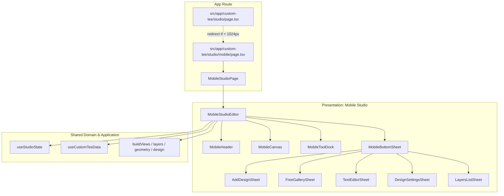

# Mobile Custom Tee Design Studio Implementation Plan

> **For agentic workers:** REQUIRED SUB-SKILL: Use superpowers:subagent-driven-development to implement this plan task-by-task. Steps use checkbox (`- [ ]`) syntax for tracking.

**Goal:** Build a dedicated, premium mobile-first Design Studio experience matching the reference design at `/custom-tee/studio/mobile`, completely decoupled in route, presentation components, and bottom sheets, with automatic mobile redirection from the desktop studio.

**Architecture:** A standalone mobile presentation module under `src/features/customTee/presentation/mobile/` that reuses existing domain models (`layers.ts`, `geometry.ts`, `views.ts`, `grouping.ts`, `design.ts`) and application hooks (`useStudioState.ts`, `useCustomTeeData.ts`). Features a touch-optimized canvas with top floating pills (Undo/Redo, Zoom/Fit), a 4-tab bottom dock (Design, Text, Images, Layers), and 5 bottom sheets (Add Design, Free Gallery, Text Editor, Design Settings, Layers List).

**Architecture Diagram:**

**Tech Stack:** Next.js App Router (TypeScript, React 19), Tailwind CSS, Lucide React icons, Vitest.

**Spec:** [docs/superpowers/specs/2026-10-28-mobile-custom-tee-design.md](file:///Users/technonext/Documents/e-commerce-app/docs/superpowers/specs/2026-10-28-mobile-custom-tee-design.md)

## Global Constraints

- Keep mobile presentation code strictly in `src/features/customTee/presentation/mobile/` and route in `src/app/custom-tee/studio/mobile/`.
- Do not break or modify existing desktop studio domain logic or tests (`vitest run` must remain 100% passing).
- Ensure all interactive elements have responsive touch targets (minimum 44x44px where possible).
- Re-use `sessionStorage` keys `custom-tee-design` and `custom-tee-selection` for cross-route persistence.

---

### Task 1: Fonts & Curated Free Gallery Artwork Assets

**Files:**
- Create: `src/features/customTee/presentation/mobile/fonts.ts`
- Create: `src/features/customTee/presentation/mobile/galleryData.ts`
- Test: `src/features/customTee/presentation/mobile/galleryData.test.ts`

**Interfaces:**
- `GALLERY_CATEGORIES`: `['All', 'Nature', 'Anime', 'Typography', 'Vintage'] as const`
- `GALLERY_ITEMS`: Array of `{ id: string, title: string, category: string, src: string, aspect: number }`
- `MOBILE_FONTS`: Array of `{ family: string, label: string, script: 'bengali' | 'latin', previewText: string }`

- [ ] **Step 1: Write test for gallery categories and items**
- [ ] **Step 2: Run test to verify it fails**
- [ ] **Step 3: Implement `fonts.ts` and `galleryData.ts` with vector SVG illustrations**
- [ ] **Step 4: Run test to verify it passes**
- [ ] **Step 5: Commit**

---

### Task 2: Bottom Sheet Drawer Base & Mobile Tool Dock & Header

**Files:**
- Create: `src/features/customTee/presentation/mobile/MobileBottomSheet.tsx`
- Create: `src/features/customTee/presentation/mobile/MobileToolDock.tsx`
- Create: `src/features/customTee/presentation/mobile/MobileHeader.tsx`
- Test: `src/features/customTee/presentation/mobile/mobileComponents.test.ts`

**Interfaces:**
- `MobileBottomSheet`: Props `{ isOpen: boolean, onClose: () => void, title: string, children: ReactNode }`
- `MobileToolDock`: Props `{ activeTab: ToolTab | null, onSelectTab: (tab: ToolTab) => void }`
- `MobileHeader`: Props `{ title: string, subtitle: string, onBack: () => void, onSave: () => void, saving: boolean }`

- [ ] **Step 1: Write test for mobile drawer and dock states**
- [ ] **Step 2: Run test to verify it fails**
- [ ] **Step 3: Implement `MobileBottomSheet`, `MobileToolDock`, and `MobileHeader`**
- [ ] **Step 4: Run test to verify it passes**
- [ ] **Step 5: Commit**

---

### Task 3: Mobile Bottom Sheets (Add Design, Gallery, Text, Settings, Layers)

**Files:**
- Create: `src/features/customTee/presentation/mobile/sheets/AddDesignSheet.tsx`
- Create: `src/features/customTee/presentation/mobile/sheets/FreeGallerySheet.tsx`
- Create: `src/features/customTee/presentation/mobile/sheets/TextEditorSheet.tsx`
- Create: `src/features/customTee/presentation/mobile/sheets/DesignSettingsSheet.tsx`
- Create: `src/features/customTee/presentation/mobile/sheets/LayersListSheet.tsx`
- Test: `src/features/customTee/presentation/mobile/sheets/sheets.test.ts`

- [ ] **Step 1: Write unit tests for sheet actions (font selection, layer setting patches, add design triggers)**
- [ ] **Step 2: Run test to verify it fails**
- [ ] **Step 3: Implement the 5 bottom sheets matching the Figma reference layout**
- [ ] **Step 4: Run test to verify it passes**
- [ ] **Step 5: Commit**

---

### Task 4: Mobile Canvas with Stage Overlays & Touch Interactions

**Files:**
- Create: `src/features/customTee/presentation/mobile/MobileCanvas.tsx`
- Test: `src/features/customTee/presentation/mobile/MobileCanvas.test.ts`

**Interfaces:**
- Renders shirt preview with hanger backdrop.
- Floating Top-Left Undo/Redo pill.
- Floating Top-Right Zoom percentage & Fit button.
- Floating Bottom Front/Back segmented pill & view thumbnails strip.
- Interactive layer bounding box with resize corners and rotation handle (`↻`).

- [ ] **Step 1: Write unit test for canvas view helpers & overlay calculations**
- [ ] **Step 2: Run test to verify it fails**
- [ ] **Step 3: Implement `MobileCanvas.tsx`**
- [ ] **Step 4: Run test to verify it passes**
- [ ] **Step 5: Commit**

---

### Task 5: Mobile Studio Editor & Page Container

**Files:**
- Create: `src/features/customTee/presentation/mobile/MobileStudioEditor.tsx`
- Create: `src/features/customTee/presentation/mobile/MobileStudioPage.tsx`

**Interfaces:**
- Connects `useStudioState`, `useCustomTeeData`, sheet visibility, active selection, and auto-open `DesignSettingsSheet` on layer click.

- [ ] **Step 1: Implement `MobileStudioEditor.tsx`**
- [ ] **Step 2: Implement `MobileStudioPage.tsx`**
- [ ] **Step 3: Verify with `npx tsc --noEmit` and `npx vitest run`**
- [ ] **Step 4: Commit**

---

### Task 6: Next.js Mobile Route & Desktop Redirection

**Files:**
- Create: `src/app/custom-tee/studio/mobile/page.tsx`
- Modify: `src/app/custom-tee/studio/page.tsx`

- [ ] **Step 1: Create `src/app/custom-tee/studio/mobile/page.tsx`**
- [ ] **Step 2: Add mobile detection & redirect in `src/app/custom-tee/studio/page.tsx`**
- [ ] **Step 3: Verify TypeScript compilation & tests**
- [ ] **Step 4: Commit**

---

### Task 7: End-to-End Verification & Browser Testing

**Files:**
- Run vitest and tsc checks
- Browser verification on mobile viewport (`390x844`)

- [ ] **Step 1: Run `npx vitest run` and `npx tsc --noEmit`**
- [ ] **Step 2: Start dev server and launch browser subagent to verify mobile UI visually**
- [ ] **Step 3: Final commit and summary**
